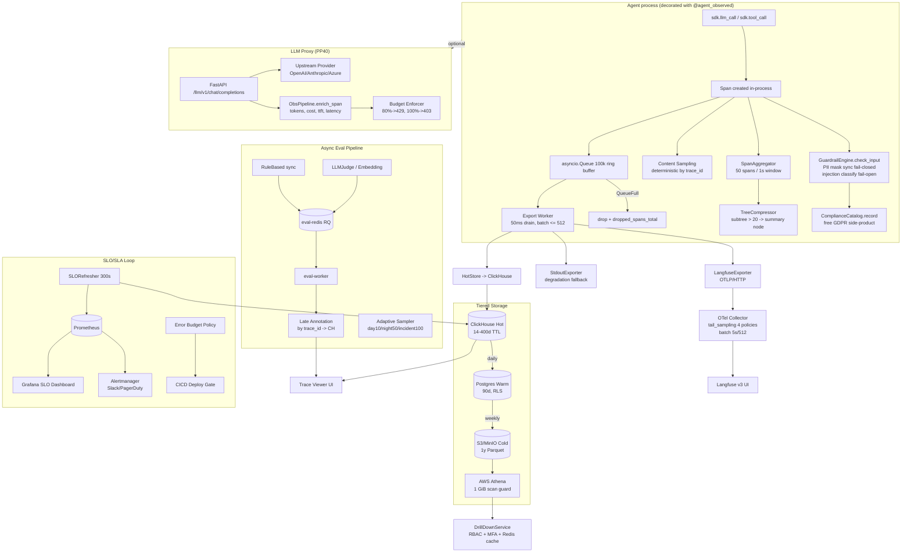
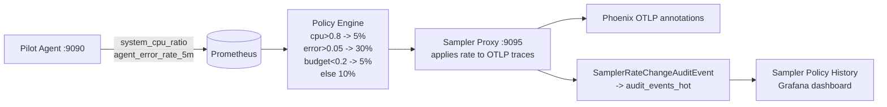
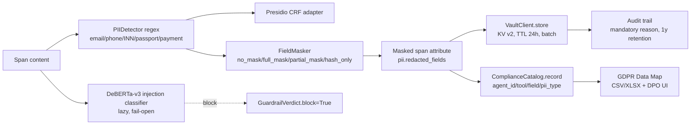

# OryaObservability

**Production-grade observability for LLM agents — traces, cost, security, eval, drift, SLOs and HA in one async Python SDK.**

[](https://www.python.org/downloads/)
[](./LICENSE)
[](#-roadmap--phases)
[](#-testing)
[](#-span-types)
[](https://opentelemetry.io/)
[](https://langfuse.com/)
[](https://clickhouse.com/)
[](https://www.vaultproject.io/)


---

> **OryaObservability** (package `agent_obs`) is a Python 3.11+ async observability SDK for LLM agents — ReAct loops, tool-calling, LangGraph / AutoGen / CrewAI style. It instruments agent loops, LLM calls and tool calls with **traces** (the primary artifact), **cost tracking**, **PII guardrails**, **content sampling**, **eval / quality**, **drift detection**, **tiered storage**, **SLO/SLA enforcement**, **RBAC + multi-tenant isolation** and **high availability**.
>
> The architecture is **TRIZ-driven**: 15 improvements across 5 observability layers (Logs/Traces, Metrics, Eval/Quality, Security, Cost/Budget) are derived from a formal inventive-problem analysis in [`analytics/ARCHITECT.md`](./analytics/ARCHITECT.md) and delivered as a single coherent implementation across three completed phases — **MVP**, **CRITICAL** and **PRODUCTION-READY**.

---

## Table of Contents

- [Overview](#-overview)
- [Key Features](#-key-features)
- [Architecture](#-architecture)
- [Span Types](#-span-types)
- [Roadmap & Phases](#-roadmap--phases)
  - [Level 1 — MVP](#level-1--mvp-p01p27)
  - [Level 2 — CRITICAL](#level-2--critical-pc01pc38)
  - [Level 3 — PRODUCTION-READY](#level-3--production-ready-pp01pp60)
  - [Level 4 — Future](#level-4--future-roadmap-only)
- [Tech Stack](#-tech-stack)
- [Project Structure](#-project-structure)
- [Quick Start](#-quick-start)
- [Configuration](#-configuration)
- [Testing](#-testing)
- [Dashboards & Observability](#-dashboards--observability)
- [Security & Compliance](#-security--compliance)
- [High Availability](#-high-availability)
- [Contributing](#-contributing)
- [License](#-license)

---

## Overview

LLM agents are hard to operate blind. Traditional APM was built for request/response services, not for multi-step agentic loops that burn tokens, call tools, branch on LLM output and occasionally leak PII. **OryaObservability** is purpose-built for that gap:

| Concern | What the SDK gives you |
| --- | --- |
| **What happened** | Full trace trees across `agent.loop` → `llm.call` / `tool.call` / `agent.reasoning`, exported via OpenTelemetry to Langfuse + ClickHouse. |
| **What it cost** | Per-call token + USD cost stamped as span attributes; tenant-aware attribution with budget enforcement. |
| **Is it safe** | In-process PII masking (fail-closed) + prompt-injection classification (fail-open) + Vault-backed recovery with TOTP MFA + audit trail. |
| **Is it good** | Rule-based, LLM-as-judge and embedding evaluators running async; late-annotation by `trace_id`; nightly golden-set regression alerts. |
| **Is it drifting** | KL-divergence over response embeddings, p99-calibrated thresholds, Alertmanager + Phoenix UMAP root-cause. |
| **Is it up** | Multi-AZ replicas for every stateful dependency, health probes + circuit breakers, graceful degradation. |
| **Who can see what** | 6-role RBAC + OPA/Rego + Postgres RLS + per-tenant Vault transit keys. |
| **Are we meeting SLOs** | 4 catalog SLOs with Google-SRE multi-window burn-rate alerting, error budgets, SLO-gated canary deploys. |

**Design principles** (from [`analytics/ROADMAP.md`](./analytics/ROADMAP.md) §1.2):

1. **Observability never blocks business logic.** Drop-on-overflow ring buffer; guardrail masking is synchronous and fast (< 5 ms p99), everything else is async.
2. **Non-contradiction.** No ticket cancels prior decisions. SDK contracts (`@agent_observed`, `llm_call()` / `tool_call()`, `BaseExporter`, `Span` / `SpanContext`, `GuardrailEngine`, `BaseEvaluator`, `BaseStorage`) are canonical and preserved across all phases.
3. **Cost is a span attribute, not a separate billing stream.** Same trace, same query, same retention.
4. **Security as a side-product of observability.** Every PII masking event populates a compliance catalog — GDPR Data Map for free.
5. **Tiered storage by access pattern.** Hot ClickHouse (14–400 d) → Warm Postgres (90 d) → Cold S3/Parquet (1 y) → Athena for on-demand drill-down.

---

## Key Features

<table>
<tr>
<td width="50%" valign="top">

### Tracing & Cost
- 6 span types (see below)
- ULID-like 26-char Crockford-base32 IDs
- `@agent_observed` decorator + `llm_call()` / `tool_call()` context managers
- Token + USD cost stamped on every `llm.call`
- `price_book.yaml` with `valid_from` / `valid_to` + cached-token pricing
- Drop-on-overflow ring buffer (100k capacity)
- Zero-overhead no-op when `enabled=False`

</td>
<td width="50%" valign="top">

### Security & PII
- Regex PII detector (email / phone / INN / passport / payment)
- Presidio adapter (CRF-ready, mock stub ships today)
- DeBERTa-v3 prompt-injection classifier (lazy, fail-open)
- Field-aware masking (no_mask / full_mask / partial_mask / hash_only)
- Vault KV v2 + Transit, 24 h TTL, TOTP MFA recovery
- Mandatory audit trail (1-year retention)

</td>
</tr>
<tr>
<td width="50%" valign="top">

### Eval & Quality
- Rule-based evaluator (regex / JSON-schema / blacklist)
- LLM-as-judge (faithfulness / relevancy / completeness)
- Embedding evaluator (cosine vs golden)
- Late annotation by `trace_id` (Redis fallback)
- Adaptive sampler: day 10 % / night 50 % / incident 100 %
- Nightly golden eval + 7-day regression alert

</td>
<td width="50%" valign="top">

### Drift & Sampling
- KL-divergence over response embeddings (15-min cron)
- p99-of-30-day calibrated thresholds (monthly)
- Phoenix UMAP root-cause visualizer
- Adaptive sampling v2: CPU / error-rate / SLO-budget driven
- Eval-aware content-sampling override
- Per-reason metrics + audit trail

</td>
</tr>
<tr>
<td width="50%" valign="top">

### Storage & Drill-down
- Hot ClickHouse (ReplicatedMergeTree + Distributed)
- Warm Postgres (RLS tenant isolation)
- Cold S3/MinIO Parquet, Hive-partitioned
- AWS Athena SQL with 1 GiB scan cost guard
- DrillDownService: RBAC + MFA + Redis cache + rate limit
- Tree compression + matreshka embedded subtrees

</td>
<td width="50%" valign="top">

### SLOs & HA
- 4 catalog SLOs (availability / latency_p95 / quality / cost_p99)
- Google-SRE multi-window multi-burn-rate alerting
- Error budget policy (soft / hard actions)
- SLO-gated canary with auto-rollback + Slack/Telegram
- ClickHouse 2×2 + Keeper 3, Postgres streaming + repmgr
- Vault raft + transit auto-unseal, mTLS mesh

</td>
</tr>
<tr>
<td width="50%" valign="top">

### RBAC & Multi-tenant
- 6 roles (admin / sre / developer / dpo / auditor / agent)
- OPA/Rego declarative policy (cross-tenant deny, MFA gate)
- ClickHouse partitioning + Postgres RLS (fail-closed)
- Per-tenant Vault transit keys + JWT/OIDC auth
- Cross-tenant access audit

</td>
<td width="50%" valign="top">

### LLM Proxy & Compliance
- FastAPI in-process proxy (`off` / `on` / `auto` + Mode B shared)
- SSE streaming with usage extraction
- Tenant-aware cost attribution + budget enforcement
- GDPR Data Map CSV/XLSX export
- Compliance UI for DPO
- 6-dependency health probes + circuit breakers

</td>
</tr>
</table>

---

## Architecture



<details>
<summary><b>Adaptive sampler loop</b> (click to expand)</summary>



</details>

---

## Span Types

The SDK emits **6 span types** (3 in MVP, +1 in CRITICAL-class work, +2 in PRODUCTION):

| Span type | Phase | Description |
| --- | --- | --- |
| `agent.loop` | MVP (P04) | Root span for one agent invocation; stamped with tail-sampling reason. |
| `llm.call` | MVP (P05) | One LLM call: model, tokens (input/output/cached), cost, finish_reason. |
| `tool.call` | MVP (P05) | One tool invocation: name, input summary, output (content-sampled). |
| `agent.reasoning` | PRODUCTION (PP08) | Micro-step span; buffered by `SpanAggregator` (50 / 1 s) into an aggregated span with embedded events. |
| `agent.reasoning.compressed` | PRODUCTION (PP17) | Tree-only summary node produced by `TreeCompressor`; **never exported**, only stored in ClickHouse for drill-down. |
| `llm.proxy.call` | PRODUCTION (PP40) | One request through the LLM proxy; enriched with bodies, ttft, latency, tenant cost attribution. |

---

## Roadmap & Phases

The project is delivered as **three completed phases** plus a fourth roadmap-only phase. Each phase is a self-contained level defined in [`analytics/ROADMAP.md`](./analytics/ROADMAP.md), with ticket-level prompts in [`analytics/MVP-PROMPT.md`](./analytics/MVP-PROMPT.md), [`analytics/CRITICAL-PROMPTS.md`](./analytics/CRITICAL-PROMPTS.md) and [`analytics/PRODUCTION-PROMPTS.md`](./analytics/PRODUCTION-PROMPTS.md).

| Phase | Level | Goal | Tickets | Status |
| --- | --- | --- | --- | --- |
| **MVP** | Level 1 (4–6 weeks) | Traces of one pilot agent visible in Langfuse UI with cost; observability never blocks business logic. | `P01`–`P27` | Done |
| **CRITICAL** | Level 2 (2–3 months) | Production-critical minimum: security, eval, drift, tiered storage, compliance. | `PC01`–`PC38` | Done |
| **PRODUCTION-READY** | Level 3 (6 months) | All non-functional targets: overhead < 2 ms p99, dropped < 0.1 %, availability 99.9 %, retention 14 d / 90 d / 1 y. | `PP01`–`PP60` | Done |
| **Level 4** | 12 months | Sidecar SDK, protobuf-first, federation, cost-aware routing, LLM-intrinsic trace PoC. | `E4.1`–`E4.7` | Roadmap only |

---

### Level 1 — MVP (`P01`–`P27`)

**Goal:** traces of one pilot agent visible in Langfuse UI with cost attributes; observability never blocks business logic.

| Ticket | What was implemented | Implementing file(s) |
| --- | --- | --- |
| **P01** | Infra: Langfuse v3 + Postgres + Redis + OTel Collector compose stack | `infra/docker-compose.yml`, `infra/otel-collector/config.yaml` |
| **P02** | `SpanContext` dataclass (ULID-like 26-char Crockford-base32 ids) | `agent_obs/observability.py` |
| **P03** | `Span` dataclass (attributes, events, timestamps, `to_dict()`) | `agent_obs/observability.py` |
| **P04** | `@agent_observed(agent_id, version)` decorator → `agent.loop` root span | `agent_obs/observability.py` |
| **P05** | `async with sdk.llm_call(...)` / `sdk.tool_call(...)` context managers | `agent_obs/observability.py` |
| **P06** | `enabled` flag → zero-overhead no-op decorators | `agent_obs/observability.py` |
| **P07** | `asyncio.Queue(maxsize=100_000)` ring buffer | `agent_obs/observability.py` |
| **P08** | Export worker (50 ms drain, batch ≤ 512, fan-out) | `agent_obs/observability.py` |
| **P09** | Drop on overflow + `dropped_spans_total` counter | `agent_obs/metrics.py`, `agent_obs/observability.py` |
| **P10** | `flush()` on shutdown (5 s timeout) | `agent_obs/observability.py` |
| **P11** | Load test (10 k spans/sec non-blocking proof) | `tests/load/test_overhead.py`, `docs/benchmarks.md` |
| **P12** | `price_book.yaml` for top-5 models | `price_book.yaml` |
| **P13** | `PriceBook` loader with `valid_from` / `valid_to` validation | `agent_obs/cost/price_book.py` |
| **P14** | `compute_cost()` with cached-token pricing | `agent_obs/cost/compute_cost.py` |
| **P15** | Cost / token attributes on `llm.call` spans | `agent_obs/observability.py`, `agent_obs/cost/compute_cost.py` |
| **P16** | `cost_per_request_usd` / `cost_total_usd` Prometheus metrics | `agent_obs/metrics.py` |
| **P17** | `LangfuseExporter.export()` batch ≤ 512 + exponential-backoff retry | `agent_obs/exporters/langfuse_exporter.py` |
| **P18** | `LangfuseExporter.flush()` | same |
| **P19** | Auth + TLS (`from_env`, basic-auth, TLS always-on, stdout degradation fallback) | `agent_obs/exporters/langfuse_exporter.py`, `agent_obs/exporters/stdout_exporter.py` |
| **P20** | Tail-sampling policy (errors / cost 100 %, security 100 %, normal 10 %) | `infra/otel-collector/config.yaml`, `agent_obs/observability.py` |
| **P21** | `tail_sampler_kept_ratio` + `kept_by_reason` recording rules | `infra/prometheus-rules.yml`, `infra/prometheus.yml` |
| **P22** | Deterministic content sampling by `trace_id` (full text 10 %, else sha256 + chars) | `agent_obs/content_sampling.py` |
| **P23** | Span attribute → Langfuse UI labels mapping (gen_ai semantic conventions) | `agent_obs/exporters/otlp_mapping.py` |
| **P24** | Three saved Langfuse queries | `docs/saved-queries.md` |
| **P25** | Support runbook (time-to-trace < 30 s) | `docs/support-runbook.md` |
| **P26** | MVP acceptance report | `docs/mvp-acceptance.md`, `tests/test_benchmark.py` |
| **P27** | Fix-prompt template | `analytics/MVP-PROMPT.md` |

**MVP span types:** `agent.loop`, `llm.call`, `tool.call`. The reference pilot agent lives in [`pilot_agent/agent.py`](./pilot_agent/agent.py) (`PilotAgent` + `PilotAgentConfig`, OpenAI async client).

---

### Level 2 — CRITICAL (`PC01`–`PC38`)

**Goal:** production-critical minimum — security (PII, injection), eval, drift, tiered storage, compliance. Without this level the agent cannot serve real users.

| Ticket | What was implemented | Implementing file(s) |
| --- | --- | --- |
| **PC01** | Tiered storage infra: ClickHouse Hot + Postgres Warm + MinIO Cold | `infra/docker-compose.yml`, `infra/storage/clickhouse_ddl.sql`, `infra/storage/postgres_warm.sql`, `infra/storage/minio_init.sh` |
| **PC02** | HashiCorp Vault with auto-unseal, `pii-recovery` + `audit` policies, SDK token | `infra/vault/vault_init.sh`, `infra/vault/policies/pii-recovery.hcl`, `infra/vault/policies/audit.hcl` |
| **PC03** | Redis + RQ workers for async eval jobs | `infra/docker-compose.yml` (eval-redis, eval-worker), `infra/eval/` |
| **PC04** | `PIIDetector` regex for email / phone / INN / passport / payment | `agent_obs/guardrail/pii_detector.py` |
| **PC05** | Presidio CRF integration (MockAnalyzer keyword stub today) | `agent_obs/guardrail/presidio_engine.py` |
| **PC06** | DeBERTa-v3 prompt-injection classifier (lazy HF load, fail-open) | `agent_obs/guardrail/injection_classifier.py` |
| **PC07** | `GuardrailEngine.check_input()` → `GuardrailVerdict` (PII + vault + injection + audit + metrics) | `agent_obs/guardrail/engine.py` |
| **PC08** | Embed guardrail into `_enqueue()` synchronously (in-process masking) | `agent_obs/observability.py` |
| **PC09** | `RuleBasedEvaluator` (regex / JSON-schema / blacklist) | `agent_obs/eval/rule_based.py` |
| **PC10** | `LLMJudgeEvaluator` (faithfulness / answer_relevancy / completeness) | `agent_obs/eval/llm_judge.py`, `agent_obs/eval/llm_judge_worker.py` |
| **PC11** | `EmbeddingEvaluator` (cosine similarity to golden) | `agent_obs/eval/embedding.py` |
| **PC12** | Late annotation: write eval results to ClickHouse by `trace_id` (Redis fallback) | `agent_obs/eval/late_annotation.py` |
| **PC13** | Eval panel in trace-viewer (pending state) + Query API | `agent_obs/eval/api.py`, `docs/eval-trace-viewer.md` |
| **PC14** | `FieldMasker` with YAML-configured per-field policies | `agent_obs/guardrail/field_masker.py`, `configs/field_masking.yaml` |
| **PC15** | Partial masking: parse SQL columns + REST JSON-path; PII column synonym dictionary | `agent_obs/guardrail/field_masker.py`, `configs/pii_columns.yaml` |
| **PC16** | `pii.redacted_fields` attribute on spans | `agent_obs/guardrail/engine.py`, `agent_obs/observability.py` |
| **PC17** | Debuggability test: 90 % traces debuggable without vault recovery | `tests/test_debuggability.py`, `docs/field_aware_masking_report.md` |
| **PC18** | `VaultClient.store` / `recover` with TTL = 24 h (real `hvac` client + batch + TTL) | `agent_obs/guardrail/vault_client.py` |
| **PC19** | TOTP MFA for vault recovery (`pyotp`) + rate limiting | `agent_obs/guardrail/vault_client.py`, `configs/mfa_authorized.yaml` |
| **PC20** | Audit trail for every vault recovery (mandatory `reason` field, 1-year retention) | `agent_obs/guardrail/audit.py`, `agent_obs/util.py` |
| **PC21** | Tiered-retention cron jobs: hourly vault TTL cleanup, daily audit archival to S3 Parquet, daily eval warm migration | `scripts/cron/cleanup_vault.py`, `scripts/cron/cleanup_audit_events.py`, `scripts/cron/cleanup_eval_results.py`, `scripts/cron/scheduler.py`, `infra/cron/Dockerfile`, `agent_obs/storage/maintenance.py` |
| **PC22** | Hot → Warm daily migration (content compression, sha256 + chars survive, full text dropped) | `scripts/cron/migrate_warm_to_cold.py`, `agent_obs/storage/maintenance.py` |
| **PC23** | Warm → Cold weekly migration (aggregates by tenant / agent / day → S3 Parquet) | `scripts/cron/migrate_warm_to_cold.py`, `infra/storage/athena_glue.sql` |
| **PC24** | Embeddings stored in `span_embeddings` sidecar table | `infra/storage/clickhouse_ddl.sql`, `agent_obs/storage/hot.py` |
| **PC25** | `DriftDetector`: KL-divergence last hour vs 7-day baseline, 15-min cron | `agent_obs/drift/detector.py`, `agent_obs/drift/kl_divergence.py`, `scripts/cron/drift_detection.py` |
| **PC26** | Monthly threshold calibration as p99 of 30-day KL history | `agent_obs/drift/threshold.py`, `scripts/cron/calibrate_drift_threshold.py`, `configs/drift_thresholds.yaml` |
| **PC27** | `DriftDetected` Alertmanager rule + 30-min suppression + Slack | `infra/prometheus-rules.yml`, `infra/alertmanager.yml` |
| **PC28** | Phoenix UMAP visualizer export for drift root-cause | `scripts/cron/export_embeddings_to_phoenix.py` |
| **PC29** | Export `system_cpu_ratio`, `agent_error_rate_5m` to sampler | `agent_obs/metrics.py`, `pilot_agent/agent.py` |
| **PC30** | Adaptive policy engine: `cpu>0.8→5%`, `error_rate>0.05→30%`, else 10 % | `scripts/sampler/policy_engine.py`, `scripts/sampler/sampler_proxy.py` |
| **PC31** | Audit trail for every rate change + Phoenix OTLP annotations | `scripts/sampler/phoenix_annotations.py`, `agent_obs/guardrail/audit.py` |
| **PC32** | `tail_sampler_current_rate` metric, status endpoint, sampler dashboard | `infra/grafana/dashboards/sampler_policy_history.json` |
| **PC33** | Compliance catalog: record every PII masking event (`agent_id`, `tool`, `field`, `pii_type`) | `agent_obs/compliance/catalog.py` |
| **PC34** | Daily aggregation cron + weekly hot → warm compliance migration | `agent_obs/compliance/aggregate.py`, `agent_obs/compliance/migrate_hot_to_warm.py`, `scripts/cron/aggregate_compliance_catalog.py` |
| **PC35** | GDPR Data Map export (CSV / XLSX) | `agent_obs/compliance/gdpr_export.py`, `agent_obs/compliance/ui.py` |
| **PC36** | Compliance UI page (Data Map) | `agent_obs/compliance/ui.py`, `docs/compliance_ui.md` |
| **PC37** | CRITICAL acceptance verification (14 exit criteria) | `scripts/acceptance/pc37_harness.py`, `scripts/acceptance/config.json` |
| **PC38** | Fix-prompt template | `analytics/CRITICAL-PROMPTS.md` |

**Storage tiers (CRITICAL):**

| Tier | Engine | Tables / objects | Retention |
| --- | --- | --- | --- |
| Hot | ClickHouse | `spans_hot`, `eval_results_hot`, `audit_events_hot`, `span_embeddings`, `tree_summaries`, `drift_history`, `compliance_catalog_hot`, `eval_golden_results` | 14–400 d |
| Warm | Postgres | `traces_warm`, `compliance_catalog`, `tenant_config` | 90 d |
| Cold | S3 / MinIO | `cold-traces`, `audit-events` (Parquet / Snappy, Hive-partitioned) | 1 year |

---

### Level 3 — PRODUCTION-READY (`PP01`–`PP60`)

**Goal:** meet all non-functional targets — overhead < 2 ms p99, dropped < 0.1 %, availability 99.9 %, retention 14 d / 90 d / 1 y. Adds adaptive sampling v2, span aggregation, tree compression, drill-down, SLO/SLA, RBAC, HA, LLM proxy.

<details>
<summary><b>PP01–PP14: HA, mTLS, sampling v2, aggregation, adaptive eval</b></summary>

| Ticket | What was implemented | Implementing file(s) |
| --- | --- | --- |
| **PP01** | HA infrastructure: multi-AZ replicas for Langfuse / CH / Vault / Redis / Postgres | `infra/docker-compose.ha.yml`, `infra/ha/README.md`, `infra/ha/healthchecks/` |
| **PP02** | mTLS + cert-management for all internal services; cert rotation (90-day cadence) | `infra/ha/certs/`, `scripts/certs/generate-ca.sh`, `scripts/certs/issue-certs.sh`, `scripts/rotate-certs.sh` |
| **PP03** | Adaptive sampling v2 policy engine: `eval.faithfulness<0.7` → content-sampling 30 % | `agent_obs/exporters/tail_sampler.py` |
| **PP04** | Feedback loop: `eval_score_avg_5m` → policy engine | `agent_obs/exporters/tail_sampler.py` |
| **PP05** | Audit trail for every policy change | `agent_obs/guardrail/audit.py` (`SamplerRateChangeAuditEvent`) |
| **PP06** | "Sampler Policy History" Grafana dashboard | `infra/grafana/dashboards/sampler_policy_history.json` |
| **PP07** | `tail_sampler_kept_ratio_by_reason{reason=error\|cost\|eval_fail\|security\|random}` metric | `agent_obs/metrics.py` |
| **PP08** | `SpanAggregator`: buffer 50 micro-spans or 1 s window | `agent_obs/span_aggregator.py`, `agent_obs/observability.py` |
| **PP09** | Embedded events as array `events: [{name, ts, attrs}, ...]` in aggregated span | `agent_obs/span_aggregator.py` |
| **PP10** | Trace-viewer expandable events UI (Playwright e2e) | `agent_obs/trace_viewer/ui.py`, `tests/e2e/test_trace_viewer_e2e.py` |
| **PP11** | Aggregation flush audit events to ClickHouse | `agent_obs/span_aggregator.py`, `infra/grafana/dashboards/span_aggregation.json` |
| **PP12** | Adaptive eval sampler (day 10 % / night 50 % / incident 100 %) | `agent_obs/eval/adaptive_sampler.py` |
| **PP13** | Nightly golden eval batch (03:00 UTC) + 7-day regression alert | `scripts/nightly_golden_eval.py`, `eval/golden/capitals.yaml`, `eval/golden/programming.yaml` |
| **PP14** | Incident-mode 100 % eval for security-incident traces + Redis rate limit (100/min) | `agent_obs/eval/adaptive_sampler.py`, `agent_obs/eval/llm_judge.py` |

</details>

<details>
<summary><b>PP15–PP24: Eval budget, tree compression, drill-down, Athena</b></summary>

| Ticket | What was implemented | Implementing file(s) |
| --- | --- | --- |
| **PP15** | Eval cost dashboard + budget enforcement (soft 80 % → 5 %, hard 100 % → stop) | `infra/grafana/dashboards/eval-cost.json`, `docs/eval-budget-runbook.md` |
| **PP16** | `TraceTreeBuilder`: tree from flat span list | `agent_obs/tree_compressor.py` |
| **PP17** | Compression policy: subtree > 20 nodes → summary node | `agent_obs/tree_compressor.py` |
| **PP18** | Async LLM summary generation for compressed nodes (Redis cache TTL 7 d) | `agent_obs/eval/tree_summary_worker.py`, `infra/storage/clickhouse_ddl.sql` |
| **PP19** | Drill-down from compressed node: restore subtree on click | `agent_obs/trace_viewer/access_control.py`, `agent_obs/trace_viewer/ui.py` |
| **PP20** | Embedded subtree (matreshka): small subtrees as event arrays (max 10) | `agent_obs/tree_compressor.py` |
| **PP21** | `DrillDownService` API: restore trace fields from tiered storage (RBAC + MFA, Redis cache TTL 600 s, rate limit 10/min/user) | `agent_obs/storage/drill_down.py` |
| **PP22** | AWS Athena integration for SQL queries on S3 Parquet | `agent_obs/storage/athena_client.py` (`AthenaCostGuardError`, 1 GiB scan guard), `infra/storage/athena_glue.sql` |
| **PP23** | Redis cache for drill-down results (10-min TTL, invalidation on late annotation / vault recovery) | `agent_obs/storage/drill_down.py` |
| **PP24** | "Drill down" button in trace-viewer for cold fields (MFA prompt) | `agent_obs/trace_viewer/ui.py`, `docs/trace-viewer.md` |

</details>

<details>
<summary><b>PP25–PP29: SLO/SLA, error budget, canary</b></summary>

| Ticket | What was implemented | Implementing file(s) |
| --- | --- | --- |
| **PP25** | SLO catalog: 4 SLOs (availability, latency_p95, quality, cost_p99) | `agent_obs/slo/definitions.py` (`SLO_CATALOG`, `SLO`, `burn_rate`, `parse_window`) |
| **PP26** | Multi-window multi-burn-rate alerting (Google SRE Workbook style) | `agent_obs/slo/burn_rate.py`, `infra/prometheus-rules.yml`, `infra/alertmanager.yml` |
| **PP27** | Error-budget tracking + policy actions (soft 20 % → sampler 5 % + eval × 0.5; hard 0 % → freeze deploys) | `agent_obs/slo/error_budget.py`, `scripts/cicd/error_budget_gate.py` |
| **PP28** | SLO Grafana dashboard (SLI, burn-rate, error-budget, overall health gauge) | `infra/grafana/dashboards/slo.json`, `docs/slo-dashboard.md` |
| **PP29** | SLO-based canary deployments: gate on burn rate, automatic rollback, Slack + Telegram notify | `scripts/canary.py`, `scripts/canary_check.py`, `agent_obs/notify.py`, `.github/workflows/canary.yml` |

</details>

<details>
<summary><b>PP30–PP34: RBAC, OPA, tenant isolation, multi-tenant Vault</b></summary>

| Ticket | What was implemented | Implementing file(s) |
| --- | --- | --- |
| **PP30** | RBAC role model: 6 roles (admin / sre / developer / dpo / auditor / agent) with discrete permission sets | `agent_obs/rbac/roles.py` |
| **PP31** | OPA / Rego policy engine (cross-tenant deny, MFA gate for `pii:recover`, role match, Redis 60 s cache) | `agent_obs/rbac/policy_engine.py`, `infra/rbac/policies/observability.rego` |
| **PP32** | Tenant isolation: ClickHouse partitioning + Postgres RLS (`tenant_isolation` policy, fail-closed) | `infra/storage/clickhouse_ddl.sql`, `infra/storage/postgres_warm.sql`, `infra/storage/migrations/001_spans_hot_tenant_partition.sql` |
| **PP33** | Multi-tenant Vault: per-tenant encryption keys (`{tenant}_pii_key` transit), JWT auth (OIDC), per-tenant policy templates | `infra/vault/policies/per-tenant.hcl`, `infra/vault/vault_init.sh`, `agent_obs/guardrail/vault_client.py` |
| **PP34** | RBAC audit trail: every access-control decision logged | `agent_obs/guardrail/audit.py` (`CrossTenantAccessAuditEvent`), `agent_obs/storage/drill_down.py` |

</details>

<details>
<summary><b>PP35–PP38: HA replication (ClickHouse / Postgres / Redis / Vault)</b></summary>

| Ticket | What was implemented | Implementing file(s) |
| --- | --- | --- |
| **PP35** | ClickHouse cluster replication + Keeper quorum (2 shards × 2 replicas + 3 Keeper) | `infra/docker-compose.ha.yml`, `infra/ha/clickhouse-cluster.xml`, `infra/ha/keeper{1,2,3}.xml`, `infra/storage/clickhouse_ddl_ha.sql`, `agent_obs/storage/hot.py` (failover 30 s cooldown), `tests/ha/test_pp35_clickhouse_replication.py` |
| **PP36** | Postgres streaming replication + pgBouncer + repmgr (1 primary + 2 standbys) | `infra/docker-compose.ha.yml`, `infra/ha/postgres/repmgr.conf`, `pgbouncer.ini`, `pg_hba_mtls.conf`, hooks |
| **PP37** | Vault raft HA + auto-unseal via transit (3 nodes, fixed-id `vault-transit-token`) | `infra/docker-compose.ha.yml`, `infra/ha/vault/vault-raft-{1,2,3}.hcl`, `agent_obs/guardrail/vault_client.py` (`VAULT_ADDRS` failover), `tests/ha/test_pp37_vault_raft.py` |
| **PP38** | Active health probes + circuit breakers for 6 deps (Langfuse / CH / PG / Vault / Redis / MinIO) | `agent_obs/ha/health_checks.py` (`HealthChecker`, `CircuitBreaker`, `circuit_breaker_for`), `tests/test_health_checks.py`, `tests/test_circuit_breaker.py`, `tests/test_pp38_degradation.py` |

</details>

<details>
<summary><b>PP39–PP44: LLM proxy mode (Mode A + Mode B)</b></summary>

| Ticket | What was implemented | Implementing file(s) |
| --- | --- | --- |
| **PP39** | Proxy config: `off` / `on` / `auto` modes, env-toggle, fail-fast validation (`ConfigError` on invalid combos) | `agent_obs/proxy/__init__.py` (`ProxyConfig`), `agent_obs/proxy/README.md` |
| **PP40** | `LLMProxyServer` FastAPI: `/llm/v1/chat/completions`, streaming SSE, header propagation, error mapping (504 / 502 / 500) | `agent_obs/proxy/server.py` |
| **PP41** | Span enrichment pipeline: bodies, tokens, cost, ttft, latency, finish_reason, content sampling | `agent_obs/proxy/obs_pipeline.py` (`ObsPipeline`, `Timing`, `parse_sse_chunk`, `iter_sse_json`), `price_book.yaml` |
| **PP42** | Tenant-aware cost attribution + budget enforcement (80 % → 429, 100 % → 403, hybrid memory + CH rollup) | `agent_obs/cost/attribution.py` (`CostAttributionTracker`, `BudgetEnforcer`, `attribution_from_headers`, `CostAttributionAuditEvent`) |
| **PP43** | Proxy failover / degradation: upstream-down → 503 | `agent_obs/proxy/server.py` |
| **PP44** | Shared obs + security proxy (Mode B, `SHARED_PROXY_ENABLED`) | `agent_obs/proxy/__init__.py`, `agent_obs/proxy/README.md` |

</details>

<details>
<summary><b>PP45–PP60: Improvements & meta</b></summary>

| Ticket | What was implemented | Implementing file(s) |
| --- | --- | --- |
| **PP45–PP48** | Mode B internals: shared decision-router + cross-system correlation + perf isolation + unified audit UI | `agent_obs/proxy/server.py`, `agent_obs/proxy/obs_pipeline.py` |
| **PP49** | Production-ready verification of all exit criteria §6.5 ROADMAP | `scripts/acceptance/` |
| **PP50** | Fix-prompt template for failed criteria | `analytics/PRODUCTION-PROMPTS.md` |
| **PP51–PP60** | Meta-observability, chaos gameday, prompt versioning, semantic cache preview, cost-aware routing preview, OPA hot-reload, drift explainability (UMAP + top-k), end-to-end PII encryption, golden-signals SLI, observability cost budget | Partial scaffolding; PP52 chaos testing → `scripts/ha-chaos-test.sh`, `tests/ha/test_chaos_scenarios.py` |

</details>

---

### Level 4 — Future (roadmap only)

Defined in [`analytics/ROADMAP.md`](./analytics/ROADMAP.md) §7 as `E4.1`–`E4.7` — **not implemented**:

- Sidecar SDK (out-of-process observability)
- Protobuf-first codegen
- Cost-aware routing
- Federation across OryaObservability instances
- LLM-intrinsic trace PoC
- Implicit eval
- Compact-embedding reconstruction

---

## Tech Stack

<table>
<tr>
<td width="50%" valign="top">

**Languages**
- Python 3.11+ (94 %) — SDK, scripts, tests, pilot agent
- Bash — cert / chaos scripts
- PowerShell — `start-all` / `stop-all`
- HCL — Vault policies
- Rego — OPA policies
- SQL — ClickHouse / Postgres / Athena DDL

**Core dependencies (light install surface, A-16)**
- `httpx` — async HTTP (exporters, proxy, OPA, Athena)
- `prometheus-client` — metrics
- `pyyaml` — configs / price book
- `jsonschema` — rule-based evaluator
- `hvac` — Vault client
- `pyotp` — TOTP MFA
- `openpyxl` — GDPR XLSX export

</td>
<td width="50%" valign="top">

**Optional extras** (`pyproject.toml`)
- `[ml]` — `openai`, `presidio-analyzer`, `spacy`, `transformers`, `torch`
- `[storage]` — `rq`, `redis`, `clickhouse-driver`, `numpy`, `psutil`
- `[api]` — `fastapi`, `uvicorn`, `pandas` (compliance-ui, trace-viewer, proxy)
- `[cron]` — `boto3`, `pyarrow`, `asyncpg`, `openai` (nightly eval)
- `[dev]` — `pytest`, `pytest-asyncio`, `respx`, `moto[s3]`, `boto3`, `pyarrow`, `cryptography`, `playwright`
- `[full]` — ml + storage

**Infrastructure (Docker Compose)**
- Langfuse v3 + langfuse-worker
- Postgres 17 (langfuse + warm_store)
- Redis 7 (langfuse + eval-redis + sentinel)
- ClickHouse 26.9 (hot tier, 2 × 2 + Keeper in HA)
- MinIO (S3 cold tier, 4-node distributed in HA)
- OTel Collector Contrib 0.128.0
- Prometheus + Alertmanager + Grafana
- HashiCorp Vault 1.18 (raft + transit unseal in HA)
- Open Policy Agent
- Arize Phoenix (drift UMAP)
- RQ eval-worker, custom cron, custom sampler-proxy, compliance-ui

</td>
</tr>
</table>

---

## Project Structure

```
OryaObservability/
├── agent_obs/                  # The SDK (Python package)
│   ├── observability.py        # Core: Span, SpanContext, ObservabilitySDK, decorators
│   ├── metrics.py              # Prometheus counters/gauges/histograms
│   ├── content_sampling.py     # Deterministic content sampling by trace_id
│   ├── span_aggregator.py      # PP08-09: 50 spans / 1s aggregation
│   ├── tree_compressor.py      # PP16-20: subtree compression + matreshka
│   ├── notify.py               # Slack + Telegram push (canary rollback)
│   ├── compliance/             # PC33-36: GDPR Data Map catalog + UI
│   ├── cost/                   # P12-16 + PP42: price book, compute_cost, attribution
│   ├── drift/                  # PC25-28: KL-divergence detector + thresholds
│   ├── eval/                   # PC09-13 + PP12-15: rule/LLM-judge/embedding + adaptive sampler
│   ├── exporters/              # P17-23 + PP03-07: Langfuse, stdout, tail_sampler v2
│   ├── guardrail/              # PC04-20: PII, injection, field masker, vault, audit
│   ├── ha/                     # PP38: health probes + circuit breakers
│   ├── proxy/                  # PP39-44: FastAPI LLM proxy + obs pipeline
│   ├── rbac/                   # PP30-31: 6 roles + OPA/Rego engine
│   ├── slo/                    # PP25-29: catalog, burn-rate, error budget, refresher
│   ├── storage/                # PC01 + PP21-23 + PP35: hot/warm/cold/athena/drill-down
│   └── trace_viewer/           # PP10/19/24: FastAPI trace viewer UI
├── analytics/                  # Source-of-truth spec (TRIZ-driven)
│   ├── ARCHITECT.md            # 5-layer architecture, 15 TRIZ improvements, 9 span types
│   ├── ROADMAP.md              # Levels 1-4, epics, exit criteria, risk register
│   ├── BACKLOG.md              # Full task backlog + coverage matrices
│   ├── MVP-PROMPT.md           # P01-P27 ticket prompts
│   ├── CRITICAL-PROMPTS.md     # PC01-PC38 ticket prompts
│   └── PRODUCTION-PROMPTS.md   # PP01-PP60 ticket prompts
├── configs/                    # YAML configs (field masking, PII columns, eval rules, drift, MFA)
├── docs/                       # Runbooks, acceptance reports, dashboard guides
├── eval/golden/                # PP13 golden eval sets (capitals, programming)
├── infra/                      # Docker Compose, OTel, Prometheus, Grafana, Vault, HA
│   ├── docker-compose.yml      # 24 services (single-node)
│   ├── docker-compose.ha.yml   # ~40 services (multi-AZ HA)
│   ├── otel-collector/         # tail_sampling + batch + otlphttp/langfuse
│   ├── storage/                # ClickHouse / Postgres / Athena DDL + migrations
│   ├── vault/                  # init script + pii-recovery / audit / per-tenant policies
│   ├── rbac/policies/          # observability.rego
│   ├── grafana/                # dashboards (sampler, slo, eval-cost, span-aggregation) + provisioning
│   ├── ha/                     # certs, clickhouse cluster, postgres repmgr, redis sentinel, vault raft, nginx
│   └── cron/                   # cron Dockerfile
├── pilot_agent/                # Reference OpenAI async agent with @agent_observed
├── scripts/                    # Operational scripts
│   ├── start-all.ps1           # PowerShell stack starter
│   ├── stop-all.ps1            # PowerShell stack stopper
│   ├── canary.py / canary_check.py  # PP29 SLO-gated canary
│   ├── nightly_golden_eval.py  # PP13 nightly golden eval
│   ├── rotate-certs.sh         # PP02 mTLS cert rotation
│   ├── ha-chaos-test.sh        # PP52 chaos scenarios
│   ├── acceptance/             # PC37 CRITICAL acceptance harness
│   ├── certs/                  # CA + service cert generation
│   ├── cicd/                   # error_budget_gate.py (PP27 deploy gate)
│   ├── cron/                   # scheduler + cleanup/migration/calibration jobs
│   └── sampler/                # policy_engine + sampler_proxy (PC30-32)
├── tests/                      # ~2,761 test functions
│   ├── e2e/                    # Playwright trace-viewer tests (PP10)
│   ├── ha/                     # chaos + PP35/PP37 replication integration
│   ├── load/                   # P11 p99 overhead tests
│   └── fixtures/               # ca.pem + prometheus rules
├── .github/workflows/canary.yml # PP29 SLO-gated canary CI/CD
├── pyproject.toml              # Package + pytest + extras
├── requirements.txt            # Flat dependency union
├── price_book.yaml             # LLM model pricing (P12)
├── AGENTS.md                   # Working spec for AI agents editing the repo
└── README.md                   # This file
```

---

## Quick Start

### Prerequisites

- Python 3.11+
- Docker + Docker Compose
- (For HA stack) 16 GB RAM, 4+ vCPU
- (For ML extras) ~3 GB model weights for DeBERTa-v3 + Presidio

### 1. Install the SDK

```bash
git clone https://github.com/reider85/OryaObservability.git
cd OryaObservability

# Editable install with dev extras (includes ML + storage + api + cron)
pip install -e ".[dev]"
```

For a minimal install (no ML / storage / API heavy deps):

```bash
pip install -e .                # core only: httpx, prometheus-client, pyyaml, jsonschema, hvac, pyotp, openpyxl
pip install -e ".[storage]"     # + clickhouse, redis, rq, numpy
pip install -e ".[ml]"          # + openai, presidio, spacy, transformers, torch
pip install -e ".[api]"         # + fastapi, uvicorn, pandas (proxy / trace-viewer / compliance-ui)
```

### 2. Bring up the infrastructure stack

**Linux / macOS** (compose directly):

```bash
cd infra
cp .env.example .env            # fill in secrets (VAULT_ROOT_TOKEN, LANGFUSE_SECRET, ...)
docker compose up -d
```

**Windows PowerShell** (managed script with health checks):

```powershell
./scripts/start-all.ps1         # validates prereqs, brings up stack, waits for health, smoke-checks
```

This starts 24 services: Langfuse v3, Postgres, Redis, ClickHouse, MinIO, OTel Collector, Prometheus, Alertmanager, Grafana, Vault, OPA, eval-worker, cron, sampler-proxy, compliance-ui, Phoenix.

### 3. Run the pilot agent

```python
import asyncio
from pilot_agent.agent import PilotAgent, PilotAgentConfig
from agent_obs import ObservabilitySDK

async def main():
    sdk = ObservabilitySDK(
        agent_id="pilot-agent",
        version="0.1.0",
        langfuse_host="http://localhost:3000",
        langfuse_public_key="pk-lf-...",
        langfuse_secret_key="sk-lf-...",
    )
    await sdk.start()

    agent = PilotAgent(PilotAgentConfig(openai_api_key="sk-..."))
    result = await agent.run("What is the capital of France?")
    print(result)

    await sdk.shutdown()

asyncio.run(main())
```

### 4. Explore

| UI | URL | Credentials |
| --- | --- | --- |
| Langfuse | http://localhost:3000 | set in `.env` |
| Grafana | http://localhost:3001 | admin / admin |
| Prometheus | http://localhost:9090 | — |
| Alertmanager | http://localhost:9093 | — |
| Phoenix | http://localhost:6006 | — |
| Compliance UI | http://localhost:8088 | — |
| Trace Viewer | http://localhost:8089 | — |
| Sampler Proxy status | http://localhost:9095/status | — |
| Cron metrics | http://localhost:9777/metrics | — |

### 5. Run the fast test suite

```bash
python -m pytest --ignore=tests/ha --ignore=tests/load -q --tb=short
```

> **Do not run bare `pytest`** — `testpaths = ["tests"]` collects `tests/ha` (Docker chaos + minute-long sleeps) and `tests/load`. See [Testing](#-testing).

---

## Configuration

The SDK is configured via environment variables and YAML files. Key env vars:

### SDK core

| Env | Default | Description |
| --- | --- | --- |
| `AGENT_OBS_ENABLED` | `1` | Master switch; `0` → zero-overhead no-op decorators. |
| `AGENT_OBS_CONTENT_RATE` | `0.1` | Deterministic content-sampling rate (by `trace_id`). |
| `AGENT_OBS_FAIL_ON_CONFIG` | `0` | `0` → degrade to `StdoutExporter` on missing Langfuse config; `1` → raise. |

### Exporters / TLS

| Env | Description |
| --- | --- |
| `LANGFUSE_HOST`, `LANGFUSE_PUBLIC_KEY`, `LANGFUSE_SECRET_KEY` | Langfuse OTLP ingest endpoint + basic auth. |
| `AGENT_OBS_TLS_CA`, `AGENT_OBS_TLS_CERT`, `AGENT_OBS_TLS_KEY` | mTLS material for exporter → OTel collector. |

### Storage

| Env | Description |
| --- | --- |
| `CLICKHOUSE_HOST` / `CLICKHOUSE_HOSTS` | Single host or comma-separated list for PP35 failover. |
| `CLICKHOUSE_USER`, `CLICKHOUSE_PASSWORD` | `observability_user` / `observability_password`. |
| `POSTGRES_WARM_URL` | Asyncpg DSN for warm tier. |
| `S3_ENDPOINT`, `S3_ACCESS_KEY`, `S3_SECRET_KEY` | MinIO / S3 cold tier. |
| `ATHENA_DATABASE`, `ATHENA_OUTPUT_LOCATION` | AWS Athena for cold drill-down. |

### Vault

| Env | Description |
| --- | --- |
| `VAULT_ADDR` / `VAULT_ADDRS` | Single addr or comma-separated for PP37 failover. |
| `VAULT_TOKEN` | SDK token with `pii-recovery` policy. |
| `VAULT_PII_TTL` | `24h` default. |
| `TOTP_SECRET_<ENGINEER>` | Per-engineer TOTP secret for MFA recovery. |

### SLO / canary / notify

| Env | Description |
| --- | --- |
| `AGENT_OBS_SLO_REFRESH_SECONDS` | `300` — SLO refresher cadence. |
| `PROMETHEUS_URL` | For canary SLO gate. |
| `AGENT_OBS_CANARY_BURN_THRESHOLD` | Override burn-rate gate threshold. |
| `SLACK_WEBHOOK_URL` | Canary rollback / drift alerts. |
| `AGENT_OBS_TELEGRAM_BOT_TOKEN`, `AGENT_OBS_TELEGRAM_CHAT_ID` | Canary rollback notify. |

### LLM Proxy (PP39–PP44)

| Env | Default | Description |
| --- | --- | --- |
| `AGENT_OBS_PROXY_MODE` | `off` | `off` / `on` / `auto` (auto = proxy when circuit breaker open). |
| `SHARED_PROXY_ENABLED` | `0` | Mode B shared obs + security proxy. |
| `LLM_UPSTREAM_URL` | — | Upstream provider base URL. |

### YAML configs (in `configs/`)

| File | Purpose |
| --- | --- |
| `field_masking.yaml` | Per-field masking policies (PC14). |
| `pii_columns.yaml` | 226-line PII column-name synonym dictionary (PC15). |
| `eval_rules.yaml` | 4 rule-based eval rules (PC09). |
| `golden_answers.yaml` | 6 golden Q/A pairs (PC11). |
| `drift_thresholds.yaml` | Per-agent KL thresholds, p99-calibrated monthly (PC26). |
| `mfa_authorized.yaml` | Authorized engineers for MFA vault recovery (PC19). |

See [`AGENTS.md`](./AGENTS.md) for the complete env var reference and gotchas.

---

## Testing

The test suite has ~2,761 test functions across four tiers:

| Tier | Command | Duration | Notes |
| --- | --- | --- | --- |
| **Fast** | `python -m pytest --ignore=tests/ha --ignore=tests/load -q --tb=short` | ~90 s | ~1,344 tests. The default verification run. |
| **HA** | `python -m pytest tests/ha/` | 30 tests, 60–120 s per fixture | Requires `docker-compose.ha.yml` up. Chaos + PP35 / PP37 replication integration. |
| **Load** | `python -m pytest tests/load/` | slow | p99 overhead tests (P11: 10 k spans/sec non-blocking). |
| **E2E** | `python -m pytest tests/e2e/` | ~30 s | Playwright browser tests for trace-viewer (PP10). Auto-skips without `playwright install chromium`. |

### Test conventions (from [`AGENTS.md`](./AGENTS.md))

- Framework: **pytest + pytest-asyncio**. `asyncio_mode = "auto"` in `pyproject.toml` — async tests run without `@pytest.mark.asyncio` (but many existing tests still have it; either works).
- **Mock heavy ML** (Presidio / DeBERTa) via `MagicMock` — never load real model weights in the fast suite.
- **Pin wall-clock** for day/night adaptive sampler tests (`freezegun` or direct monkeypatch).
- **Patch `scripts.cron.scheduler.<name>`** not source modules (the scheduler imports at module load).
- `tests/fixtures/ca.pem` — self-signed CA for mTLS tests.
- `tests/conftest.py` — autouse fixture resetting the process-wide circuit-breaker registry (PP38).
- `pytest-timeout` is **not installed** — `--timeout=N` fails with "unrecognized arguments".

### Linting & types

- **Ruff** and **mypy** run with defaults (no config in `pyproject.toml`). Baseline is intentionally dirty (~830 ruff, ~116 mypy findings). **Fix only findings in files you touched** — do not attempt a repo-wide cleanup in a single PR.
- `mypy_cache/3.14/` is committed by accident in some checkouts; ignore it.

---

## Dashboards & Observability

Grafana dashboards ship in [`infra/grafana/dashboards/`](./infra/grafana/dashboards/) and are auto-provisioned:

| Dashboard | File | Phase | What it shows |
| --- | --- | --- | --- |
| **Sampler Policy History** | `sampler_policy_history.json` | PP06 | Sampling rate over time with rate-change annotations from `audit_events_hot`. |
| **SLO** | `slo.json` | PP28 | 4 SLOs: SLI, burn-rate, error-budget, overall health gauge + drill-down into budget-burning traces. |
| **Eval Cost** | `eval-cost.json` | PP15 | Eval spend vs budget, soft / hard enforcement actions. |
| **Span Aggregation** | `span_aggregation.json` | PP11 | Aggregation flush events + network traffic reduction. |

**Prometheus recording rules** (`infra/prometheus-rules.yml`, 524 lines):

- `tail_sampler` recording rules (kept ratio by reason)
- `cron` group (CronTargetDown, hourly / daily / weekly staleness, migration failed)
- `drift-detector` group (KL score, threshold breached)
- `slo-burn-rate` group (PP26 multi-window)
- `error-budget` rules (PP27)
- `dependency-health` rules (PP38)

**Alertmanager** (`infra/alertmanager.yml`) routes:

- `component=drift-detector` → 30-min suppression → Slack
- `component=ha` → Slack (PP38 dependency health)
- `severity=critical` → Slack
- SLO fast-burn page → PagerDuty

---

## Security & Compliance

### PII guardrail pipeline (PC04–PC20)



**Field-aware masking** (PC14–PC17):

| Field | Policy | Why |
| --- | --- | --- |
| `system_prompt` | `no_mask` | Needed for reproducibility; no user PII. |
| `user_message` | `full_mask` | Highest PII density. |
| `tool_output` | `partial_mask` | Parse SQL columns + JSON paths; 226-line synonym dictionary. |
| `llm_output_text` | `full_mask` | May echo PII back. |
| `tool_input_summary` | `hash_only` | Structural debugging only. |

**Target met (PC17):** 90 % of traces debuggable without vault recovery.

### Vault recovery (PC18–PC20, PP19, PP33, PP37)

- Real `hvac` client, KV v2 + Transit, TTL 24 h, batch operations.
- TOTP MFA (`pyotp`) for any recovery; rate-limited.
- Mandatory `reason` field on every recovery; 1-year audit retention.
- Multi-tenant: per-tenant transit keys (`{tenant}_pii_key`) + JWT/OIDC auth + per-tenant policy templates.
- HA: 3-node raft + transit auto-unseal; `VAULT_ADDRS` failover in SDK.

### RBAC (PP30–PP31, PP34)

- **6 canonical roles** with discrete `frozenset[str]` permission sets: `admin`, `sre`, `developer`, `dpo`, `auditor`, `agent`.
- `RBAC.check()` — sync, fail-closed, `MemoryRoleStore` / `PostgresRoleStore`.
- `PolicyEngine.check()` — async, OPA / Rego (`infra/rbac/policies/observability.rego`):
  - Cross-tenant deny (default).
  - MFA gate for `pii:recover` and `audit:read:raw`.
  - Role match (fail-closed default).
- Redis 60 s decision cache (sha256 key, fail-open on Redis down).
- Every access-control decision logged as `CrossTenantAccessAuditEvent`.

### Tenant isolation (PP32)

- **ClickHouse**: `PARTITION BY (tenant_id, ...)` — physical separation.
- **Postgres**: RLS `tenant_isolation` policy — fail-closed (no tenant context = no rows).
- Idempotent migration: `infra/storage/migrations/001_spans_hot_tenant_partition.sql`.

### Compliance catalog (PC33–PC36)

Every PII masking event is recorded as a free side-product:

- `ComplianceCatalog.record(agent_id, tool, field, pii_type)` — sync dict increment, no I/O on the hot path.
- Background Postgres batched UPSERTs (1-min flush).
- Daily aggregation → `compliance_catalog` warm table.
- Weekly hot → warm migration (14-day hot retention).
- GDPR Data Map CSV / XLSX export (`agent_obs/compliance/gdpr_export.py`).
- DPO web UI (`agent_obs/compliance/ui.py` — FastAPI service).

---

## High Availability

The HA stack (`infra/docker-compose.ha.yml`, ~40 services) delivers 99.9 % availability:

| Component | Topology | Failover |
| --- | --- | --- |
| **ClickHouse** | 2 shards × 2 replicas + 3 Keeper (PP35) | `CLICKHOUSE_HOSTS` failover, 30 s cooldown, sticky active replica; ReplicatedMergeTree + Distributed tables. |
| **Postgres** | 1 primary + 2 standbys + repmgr + 2 pgBouncer (PP36) | Streaming replication; promote / follow / rejoin hooks. |
| **Redis** | 1 master + 2 replicas + 3 Sentinel (PP36) | Sentinel-driven failover. |
| **Vault** | 3 nodes raft + transit auto-unseal (PP37) | `VAULT_ADDRS` failover; auto-unseal < 60 s. |
| **MinIO** | 4 nodes erasure coding | Distributed mode. |
| **OTel Collector** | 3 replicas + nginx LB | Round-robin. |
| **Langfuse** | 3 replicas + nginx LB (sticky sessions) | Per-session affinity. |

### Health probes & circuit breakers (PP38)

`agent_obs/ha/health_checks.py` exposes:

- `HealthChecker` — 6 active probes (Langfuse / ClickHouse / Postgres / Vault / Redis / MinIO) publishing `agent_obs_dependency_health` gauge.
- `CircuitBreaker` — closed → open at threshold, half-open single-flight, configurable recovery window.
- `circuit_breaker_for(dependency)` — per-dependency fail-fast: when open, **skip the driver / HTTP call entirely** (graceful degradation).

### mTLS mesh (PP02)

- Internal CA (`scripts/certs/generate-ca.sh`), per-service certs (`scripts/certs/issue-certs.sh`).
- 90-day rotation cadence (`scripts/rotate-certs.sh`): re-issue, refresh volumes, rolling-reload, validate mTLS handshake.
- SDK-side: `AGENT_OBS_TLS_CA` / `AGENT_OBS_TLS_CERT` / `AGENT_OBS_TLS_KEY`.
- Public endpoints refuse connections without a client cert.

### Chaos testing (PP52)

- `scripts/ha-chaos-test.sh` (402 lines): kill CH replica, PG standby, Redis replica, Vault node, OTel, Langfuse.
- `tests/ha/test_chaos_scenarios.py`: Docker-driven chaos scenarios.
- `tests/ha/test_pp35_clickhouse_replication.py`: Keeper quorum, ReplicatedMergeTree DDL, SDK failover < 10 s, resync after restart.
- `tests/ha/test_pp37_vault_raft.py`: raft quorum, leader loss → SDK continues < 5 s, auto-unseal < 60 s.

---

## Contributing

Contributions are welcome! Please read **[CONTRIBUTING.md](./CONTRIBUTING.md)** before opening a pull request.

Key points:

- The project follows a strict **non-contradiction principle** — no PR may break canonical SDK contracts.
- The fast test suite (`pytest --ignore=tests/ha --ignore=tests/load -q`) must pass.
- Fix ruff / mypy findings **only in files you touched** — the baseline is intentionally dirty.
- Security-sensitive changes (guardrail, vault, RBAC) require extra review and may require acceptance-harness updates.
- See [`AGENTS.md`](./AGENTS.md) for the working spec, env var reference, and gotchas.

---

## License

Licensed under the **Apache License, Version 2.0** — see [LICENSE](./LICENSE).

```
Copyright 2026 Vasiliy Zhila (Reider85)

Licensed under the Apache License, Version 2.0 (the "License");
you may not use this file except in compliance with the License.
You may obtain a copy of the License at

    http://www.apache.org/licenses/LICENSE-2.0

Unless required by applicable law or agreed to in writing, software
distributed under the License is distributed on an "AS IS" BASIS,
WITHOUT WARRANTIES OR CONDITIONS OF ANY KIND, either express or implied.
See the License for the specific language governing permissions and
limitations under the License.
```

---

**Built with the [TRIZ](https://en.wikipedia.org/wiki/TRIZ) methodology** — 15 inventive improvements across 5 observability layers.

[Report Bug](https://github.com/reider85/OryaObservability/issues) · [Request Feature](https://github.com/reider85/OryaObservability/issues) · [Roadmap](./analytics/ROADMAP.md)

